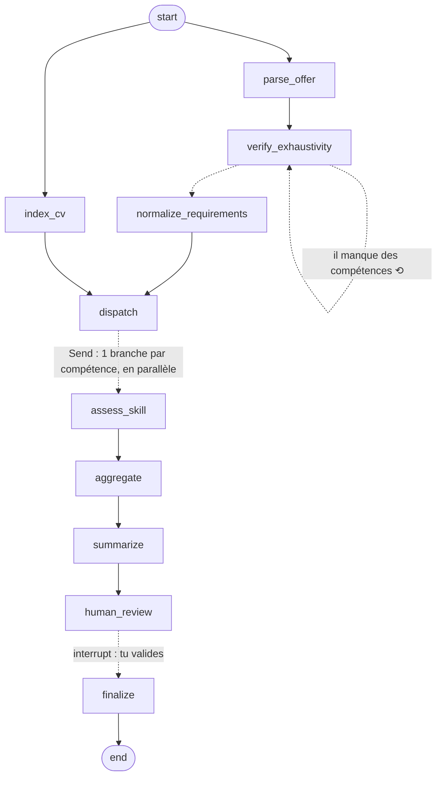

# cvmatch : adapter son CV à une offre, compétence par compétence

Un outil pour **candidats** : tu donnes ton CV et une offre, il te rend une **carte de couverture** (pour
chaque compétence de l'offre : est-elle prouvée dans ton CV, et que faire ?), un **score**, des
**reformulations** de tes propres lignes et la liste honnête de tes **lacunes**. Il n'invente jamais
d'expérience.

Stack : **LangGraph** (orchestration agentique), **RAG** (preuves retrouvées dans le CV), **GenAI**
(extraction, jugement, rédaction), **Pydantic** (sorties structurées), **FastAPI**, tests **pytest**.

---

## 1. Démarrage rapide

Deux parties : l'**API** Python (le moteur d'analyse) et le **site web** Next.js (dossier `web/`).

```bash
# --- API -------------------------------------------------------------
python -m venv .venv && source .venv/bin/activate        # Windows : .venv\Scripts\activate
pip install -e ".[dev,api,openai]"
cp .env.example .env                                      # LLM_PROVIDER=fake (démo) ou azure (+ clés)
uvicorn cvmatch.api:app --reload                          # http://localhost:8000

# --- Site web (dans un 2e terminal) ----------------------------------
cd web && cp .env.example .env.local && npm install
npm run dev                                               # http://localhost:3000

# --- Autres usages -----------------------------------------------------
cvmatch --cv data/sample_cv.md --offer data/sample_offer.txt   # ligne de commande
streamlit run streamlit_app.py                                 # ancienne interface (pip install -e ".[ui]")
pytest                                                         # 125 tests, hors ligne
```

`LLM_PROVIDER=fake` = LLM factice à règles : aucune clé, sert à voir tourner toute la plomberie.

### Avec un vrai LLM

| Fournisseur | Variables à renseigner dans `.env` |
|---|---|
| `azure` | `AZURE_OPENAI_ENDPOINT`, `AZURE_OPENAI_API_KEY`, `AZURE_OPENAI_DEPLOYMENT`, `AZURE_OPENAI_API_VERSION` |
| `openai` | `OPENAI_API_KEY`, `LLM_MODEL` (défaut `gpt-4o-mini`) |
| `anthropic` | `ANTHROPIC_API_KEY`, `LLM_MODEL` (obligatoire) |
| `ollama` | `LLM_MODEL` (défaut `llama3.1`), Ollama lancé en local |

`LLM_TEMPERATURE=none` si ton modèle refuse le paramètre `temperature`.
Embeddings optionnels pour le RAG : `EMBEDDINGS_PROVIDER=openai|azure|ollama` (sinon BM25 seul, déjà efficace sur un CV).
`MAX_CONCURRENCY` (défaut 5) borne les compétences évaluées en parallèle, pour rester sous le quota du fournisseur.

### API

| Route | Rôle |
|---|---|
| `POST /analyze/stream` | multipart : `offer_text` + `cv_file` (pdf/md/txt) **ou** `cv_text` → avancement en direct (Server-Sent Events `progress`), puis `result` ou `error`. Utilisée par le site. |
| `POST /analyze` | `{"cv_text": "...", "offer_text": "..."}` → résultat complet (JSON) |
| `POST /analyze/upload` | multipart : `cv_file` + `offer_text` → résultat complet |
| `POST /score` | `{"assessments": [...], "approved_ids": [...]}` → score final, sans LLM (à rappeler à chaque case cochée) |
| `POST /report` | `{"result": {...}, "approved_ids": [...]}` → bilan Markdown, sans LLM |
| `GET /example` | CV et offre fictifs (public) |
| `GET /health` | état et fournisseur configuré (public) |

`ALLOWED_ORIGINS` liste les adresses du site autorisées à appeler l'API (CORS). Si `API_KEY` est défini,
l'en-tête `X-API-Key` est exigé. Tailles d'entrée, analyses par heure et par jour sont bornées (voir
`.env.example`) : chaque analyse coûte 20 à 50 appels LLM.

---

## Déploiement (démo publique avec Azure OpenAI)

Deux services : l'API (image Docker) et le site (Next.js, idéalement sur Vercel, gratuit).
Garde-fous intégrés : taille du CV/de l'offre, PDF ≤ 5 pages, 5 analyses par visiteur et par heure, 100 par
jour au total (`RATE_LIMIT_PER_HOUR=0` met la démo en pause). Fixe aussi une **alerte de budget** dans Azure.

1. **API** sur un hébergeur Docker (Render, Railway, Fly.io, Azure Container Apps, Hugging Face Spaces) :
   `docker build -t cvmatch-api .` ; l'image écoute sur `$PORT` (défaut 8000). Secrets à définir chez
   l'hébergeur (jamais dans le dépôt) : `LLM_PROVIDER=azure`, `AZURE_OPENAI_ENDPOINT`, `AZURE_OPENAI_API_KEY`,
   `AZURE_OPENAI_DEPLOYMENT`, `AZURE_OPENAI_API_VERSION`, (`EMBEDDINGS_PROVIDER=azure`,
   `AZURE_OPENAI_EMBEDDINGS_DEPLOYMENT`), et `ALLOWED_ORIGINS=https://<ton-site>.vercel.app`.
2. **Site** sur Vercel : *Add New Project* → importe le dépôt → *Root Directory* : `web` → variables
   `NEXT_PUBLIC_API_URL=https://<ton-api>` et `NEXT_PUBLIC_GITHUB_URL` (optionnel).

La CI GitHub Actions (`.github/workflows/ci.yml`) lance les tests Python, construit le site et l'image Docker à chaque push.

---

## 2. Comprendre le projet, couche par couche

### Couche 1 : le problème
Une offre contient des **exigences** (Python, MLOps, API REST…). Un CV contient des **preuves** (lignes de
projets, d'expériences). Pour chaque exigence, on cherche la preuve et on classe la situation en 4 statuts :

| Statut | Sens | Action proposée |
|---|---|---|
| ✅ **visible** | le CV emploie les mots exacts de l'offre | rien |
| 🟡 **hidden** (cachée) | le CV prouve la compétence avec d'autres mots (« apprentissage profond » vs « deep learning ») | reformuler avec les mots de l'offre |
| 🟠 **implicit** | la compétence se déduit d'un outil ou projet sans être nommée (FastAPI → API REST) | la rendre explicite |
| ❌ **absent** | aucune preuve | lacune honnête, rien à inventer |

Pourquoi « visible » ≠ « hidden » : les ATS et les recruteurs pressés cherchent les **mots exacts** de l'offre.

### Couche 2 : le principe central, *le LLM propose, le code vérifie*
Un LLM seul peut inventer une preuve, se tromper de statut ou halluciner un chiffre. Donc chaque sortie du
LLM passe par des contrôles déterministes (`src/cvmatch/verification.py`) avant d'entrer dans le rapport :

1. une preuve citée doit exister **mot pour mot** dans le CV (sinon : rejet et nouvel essai, puis repli sur « absent ») ;
2. « visible » vs « hidden » est **tranché par le code** (le terme exact de l'offre est-il dans la preuve ?) ;
3. une réponse « absent » est rejetée si le terme de l'offre figure pourtant dans les extraits ;
4. une reformulation ne peut ni inventer de chiffres, ni ajouter d'outils absents de la preuve.

Et le **score est calculé en code** (`scoring.py`), jamais par le LLM : reproductible, auditable, testable.

### Couche 3 : le graphe LangGraph



`assess_skill` est lui-même un **sous-graphe** : `retrieve → judge → verify`, et `verify` renvoie vers
`judge` avec la liste des erreurs tant que le verdict est rejeté (3 essais maximum). C'est la boucle agentique.

### Couche 4 : où est chaque technique

| Technique | Où dans le code | Rôle |
|---|---|---|
| **GenAI / LLM** | `prompts.py`, `llm.py`, `graph.py` | extraction des exigences, jugement par compétence, synthèse |
| **Sorties structurées** | `schemas.py` | chaque réponse LLM est validée par un schéma Pydantic |
| **RAG** | `ingestion.py`, `retrieval.py` | le CV est découpé en chunks ; pour chaque compétence, on retrouve 4 chunks (BM25 + embeddings optionnels, fusion RRF, requête enrichie de synonymes et de déclencheurs implicites) ; le juge ne voit que ces extraits |
| **LangGraph** | `graph.py` | état partagé, branches parallèles `Send` (map-reduce), boucles conditionnelles, sous-graphe, `interrupt` |
| **Agentique** | `graph.py`, `verification.py` | le système décide : relancer l'extraction s'il manque des compétences, renvoyer un verdict au juge s'il est rejeté, s'arrêter pour validation humaine |
| **Référentiel** | `taxonomy.py`, `taxonomy_default.py` | synonymes FR/EN, déclencheurs implicites, règle « la mention la plus longue gagne » |

### Couche 5 : les sorties
Tableau de couverture, **3 scores** (actuel, potentiel si tout est appliqué, final selon tes validations),
reformulations *avant / après* triées par gain, mots-clés de l'offre à intégrer (uniquement pour des
compétences que tu as déjà), lacunes, notes de contrôle (verdicts « à vérifier » signalés par ⚠).

---

## 3. Carte du code

```
src/cvmatch/
  config.py        paramètres et pondérations du score        graph.py        LE graphe LangGraph
  schemas.py       tous les schémas Pydantic                  verification.py garde-fous anti-hallucination
  text_utils.py    normalisation, recherche de citations      scoring.py      score, suggestions, mots-clés, lacunes
  taxonomy*.py     référentiel de compétences                 report.py       rapport Markdown
  ingestion.py     lecture txt/md/pdf + chunking              pipeline.py     analyze(cv, offre)  <- point d'entrée
  retrieval.py     BM25 + embeddings + RRF                    cli.py / api.py ligne de commande / FastAPI
  limits.py        garde-fous d'usage (taille, débit, quota)
web/               site Next.js (saisie, avancement en direct, bilan)
  llm.py           fournisseurs LLM et embeddings             fake_llm.py     LLM factice (démo, tests, CI)
  prompts.py       prompts
evaluation/        générateur de cas synthétiques, baselines, run_eval
tests/             125 tests (garde-fous, boucles, propriétés, bout en bout)
data/              CV et offre d'exemple (fictifs)
```

---

## 4. Évaluation sans annotation manuelle

On **fabrique** les cas, donc on connaît la bonne réponse à l'avance (`evaluation/synthetic.py`) :

- mode `templated` : CV et offre assemblés avec les 4 statuts connus ;
- mode `perturb` : on part de **ton vrai CV** et on le perturbe (lignes supprimées, termes remplacés par des
  synonymes). La vérité est recalculée à partir du CV final.

```bash
python -m evaluation.run_eval --n 30 --mode both --base-cv data/private/mon_cv.md --provider azure
python -m evaluation.run_eval --n 50 --provider openai --direct-baseline   # + baseline « 1 seul prompt »
```

Mesures : précision/rappel d'extraction, exactitude du statut (matrice de confusion), taux de citations
introuvables (hallucinations), taux de boucles de correction, erreur et corrélation de Spearman du score,
comparé à une baseline TF-IDF et (avec `--direct-baseline`) à un LLM sans RAG ni garde-fous.

> ⚠ **Avec le LLM factice (`LLM_PROVIDER=fake`) les chiffres sont ~100 %, c'est normal** : il utilise la
> même taxonomie que la vérité terrain. Cela prouve que la plomberie est juste (RAG, boucles, score), pas
> que ton modèle est bon. **Les chiffres qui comptent pour ton CV sont ceux obtenus avec un vrai LLM.**
> Vérifie aussi à la main ~15 cas dans `evaluation/results/*.json` (≈ 20 min) pour pouvoir annoncer un taux d'accord humain.

Autres propriétés testées sans annotation (`tests/test_properties.py`) : ajouter une preuve ne fait jamais
baisser le score ; changer l'ordre des sections ne change rien ; même entrée → même sortie ; aucune
citation inventée.

---

## 5. Limites connues (à connaître avant de s'en servir)

- **Jamais exécuté avec un vrai LLM ni de vrais embeddings** : le code qui les appelle (`llm.py`) est testé
  avec des doublures, pas contre une API. Premier réflexe : lancer `run_eval` avec ton fournisseur.
- Le juge ne voit que les `TOP_K` extraits retrouvés ; un verdict « absent » est toutefois contrôlé sur
  tout le CV, et l'extrait manquant lui est renvoyé s'il contient le terme.
- Les compteurs de débit sont en mémoire : valables pour une instance unique (suffisant pour une démo).
- Le statut **implicit** est le plus subjectif : à relire. La validation humaine est là pour ça.
- Le référentiel livré (~60 compétences IA/data/MLOps) est modeste : hors référentiel, le LLM travaille sans
  filet lexical (la vérification des citations, elle, reste active). Étends-le avec `Taxonomy.from_json(...)` ou ESCO.
- Les contrôles de reformulation attrapent les chiffres et outils inventés, pas toutes les dérives de sens.
- Les PDF à deux colonnes peuvent être extraits dans le désordre ; préfère un CV mono-colonne ou un `.md`.
- Ne versionne jamais de vrais CV (RGPD) : `data/private/` est ignoré par git.

## 6. Pistes d'évolution

Checkpointer SQLite/Postgres pour reprendre une validation interrompue ;
traces **LangSmith** (`LANGSMITH_TRACING=true`) ; juge LLM « plus fort » pour pré-annoter l'évaluation ;
génération de lettre de motivation à partir des preuves vérifiées ; mode recruteur (classer plusieurs CV).
